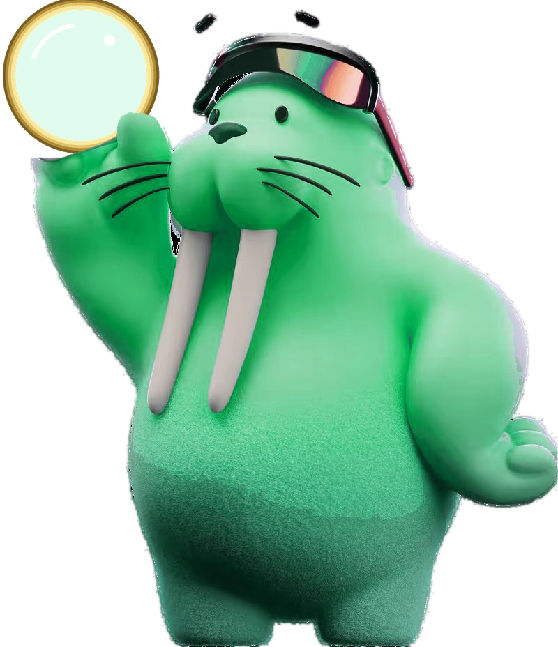
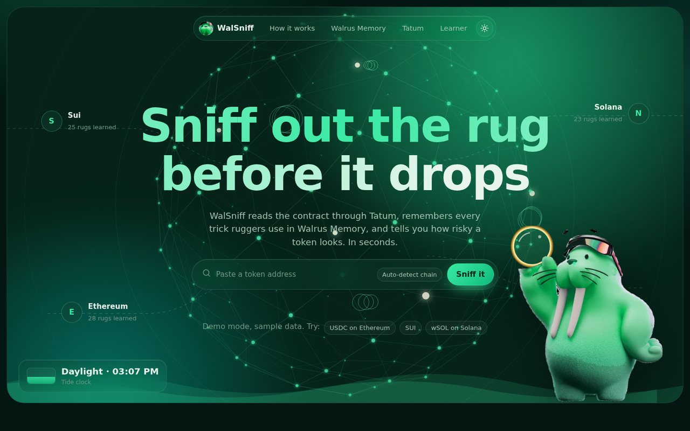
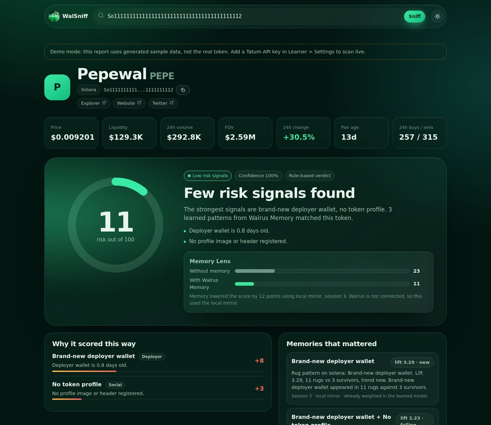
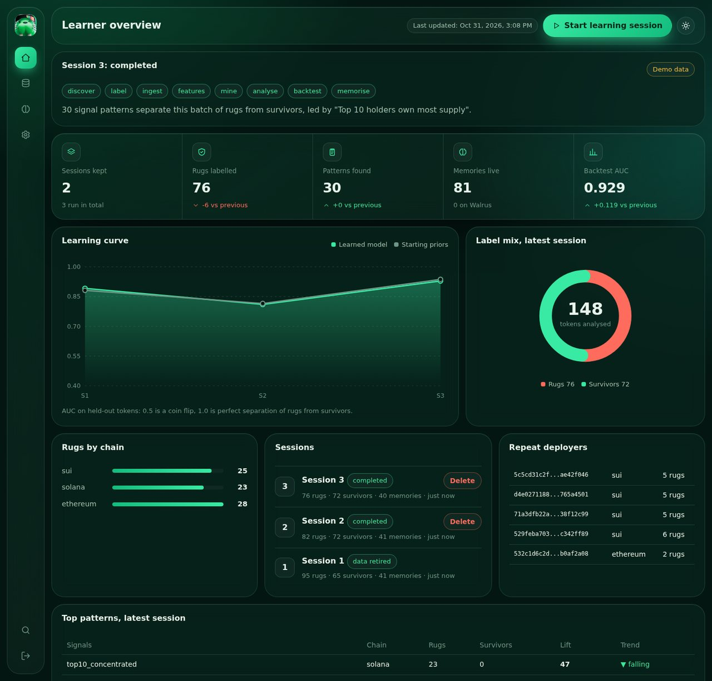
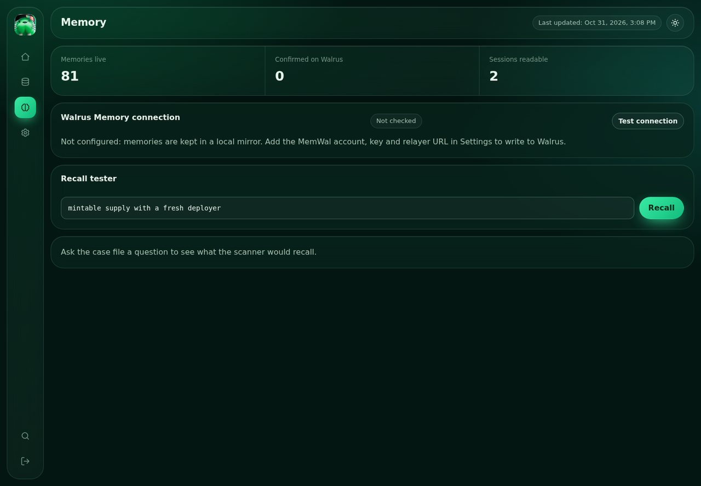
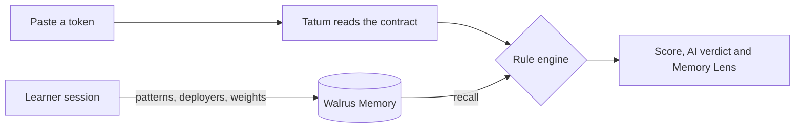

<div align="center">



# WalSniff

**Sniff out the rug before it drops.**

An AI detective that learns how crypto scams work, remembers every trick in **Walrus Memory**, and reads contracts on **Sui, Solana and Ethereum** through **Tatum**.

<p>
  
  
  
  
</p>



<sub>Screenshots use the built-in demo data, so they work without any API keys.</sub>

</div>

<br />

## Two halves, one shared memory

<table>
<tr>
<td width="50%" valign="top">

### 🔎 Sniff (public)
Paste a token address. Get a **0 to 100 risk score**, an **AI verdict**, the exact signals behind it, and a **Memory Lens** showing how much Walrus Memory changed the score.



</td>
<td width="50%" valign="top">

### 🧠 Learner (admin)
Run a learning session. WalSniff finds fresh rugs and survivors, mines the patterns that separate them, backtests the new model, and writes what it learned to Walrus Memory.



</td>
</tr>
</table>

## How Walrus Memory makes it smarter

Walrus Memory is the brain, not a side feature. Every learning session writes to its own namespace (`walsniff-s1`, `s2`, ...):

| Written by the Learner | Used by the Scanner |
|---|---|
| **Patterns**: signal combinations that show up in rugs far more than in survivors, with lift and trend | Matching patterns raise the score and appear in the report |
| **Repeat deployers**: wallets behind several rugs | A known rug deployer is flagged straight away |
| **Code clusters**: contracts that share the same fingerprint | Copy-paste rugs are caught even when the name changes |
| **Model weights**: the risk model, retrained and backtested each session | Every scan scores with the latest learned weights |

<div align="center">

</div>

- **Memory Lens** shows the score *without* memory next to the score *with* it, so you see exactly what was learned.
- **Always fresh**: only the latest two sessions are kept. Older ones are retired, so WalSniff chases the tricks ruggers use *now*.
- **Honest when offline**: if Walrus is unreachable, a local mirror takes over and the page says so.
- Writes use `remember` with an idempotency key, are confirmed with `waitForRememberJob`, and recalls are semantic.

## How Tatum gives it eyes

One Tatum key reads all three chains the same way:

| Chain | Transport | What WalSniff reads |
|---|---|---|
| **Sui** | gRPC (`sui-mainnet-grpc.gateway.tatum.io`) | Move package functions (can a public function mint through the `TreasuryCap`?), coin info and supply, deny list, frozen metadata, the deployer |
| **Solana** | JSON-RPC | Mint and freeze authority, Token-2022 extensions, largest holders, deployer |
| **Ethereum** | JSON-RPC | Bytecode (`eth_getCode`) decoded for mint, blacklist, tax and trading switches, proxy slots, owner |

The Learner uses the **same collector** as the Scanner, so what it learns applies to what you paste. Market data comes from DexScreener and GeckoTerminal, and sniffer scores from TokenSniffer and SolSniffer when keys are set.



## Quick start

```bash
npm install
npm test
npm start          # http://localhost:3000
```

1. Open `/admin`. On first run the console prints a **setup code**; use it to create the admin password (or set `ADMIN_PASSWORD`).
2. With no keys, WalSniff runs in **demo mode** with clearly labelled sample data.
3. Add keys in **Learner > Settings** (encrypted at rest) and press each **Test** button.
4. Press **Start learning session** twice, so trends and the learning curve appear.

| Setting | Purpose |
|---|---|
| `TATUM_API_KEY` | Mainnet key from dashboard.tatum.io (turns demo mode off) |
| `MEMWAL_PRIVATE_KEY` | 32-byte Ed25519 delegate key as 64 hex characters |
| `MEMWAL_ACCOUNT_ID`, `MEMWAL_SERVER_URL` | Your Walrus Memory account and relayer |
| `OPENROUTER_API_KEY` | AI verdict and pattern notes (a rule-based verdict is used without it) |
| `TOKENSNIFFER_API_KEY`, `SOLSNIFFER_API_KEY`, `ETHERSCAN_API_KEY` | Optional extra evidence |
| `SESSION_SECRET` | Optional. Encrypts saved keys and signs admin cookies; otherwise generated into `data/.session-secret` |
| `SUI_GRPC_MODE=web` | Optional. Use gRPC-Web if your host blocks HTTP/2 |

Run `npm run probe:sui` with `TATUM_API_KEY` set to print what the Sui gRPC gateway returns.

## Project map

| Area | Where |
|---|---|
| Evidence collector (shared) | `server/lib/evidence.js`, `contract.js`, `adapters/suigrpc.js` |
| Risk model and backtest | `server/lib/model.js` |
| Learning sessions | `server/lib/learner.js` |
| Scanner and Memory Lens | `server/lib/scanner.js` |
| Walrus Memory client | `server/lib/adapters/memory.js` |
| UI | `web/` (plain JavaScript, no framework) |

## Security notes

- Saved keys are AES-256-GCM encrypted, and the encryption secret is **never stored in `db.json`**.
- `data/` is git-ignored. Never commit it: it holds your encrypted keys and admin hash.
- Admin login is rate limited, cookies are `HttpOnly` and `SameSite=Strict`, and every write needs a custom header.

<div align="center">
<sub>WalSniff reports risk signals, not verdicts of fraud. It cannot prove a token is safe or a scam, so always do your own research. Built for the Tatum x Walrus Total Recall hackathon.</sub>
</div>
